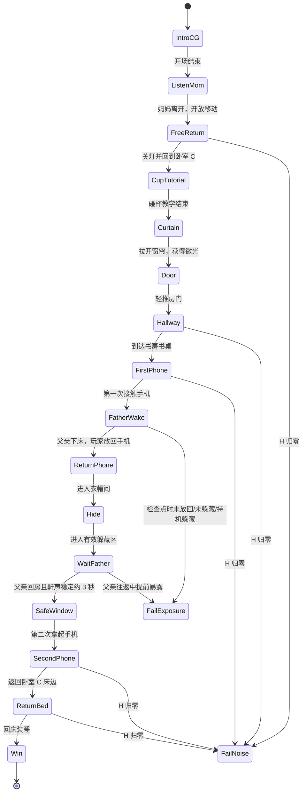

# 《偷机》完整流程线（程序执行版）

> 目标：把原策划的关卡流程整理成可直接做状态机和验收的线性流程。  
> 原则：主路线只有一条；父亲事件固定；第一次取机与第二次取机规则不同。

## 01｜主流程总览

## 02｜逐段流程

| 编号 | 状态 | 玩家要做什么 | 系统发生什么 | 进入下一段的条件 |
|---|---|---|---|---|
| S00 | 开场 CG | 观看妈妈没收手机 | 妈妈走向书房，放下手机后离开 | CG 结束 |
| S01 | 客厅听声 | 固定视角听妈妈脚步 | 脚步、书房门、手机放置声依次播放 | 妈妈离开，输入开放 |
| S02 | 关灯回房 | 关客厅灯，走回卧室 C | 灯开关接触声；地面为瓷砖/木地板 | 到达卧室 C |
| S03 | 碰杯教学 | 在床边整理时撞掉水杯 | 陶瓷碰木地板；鼾声短暂进入 S2 再回 S1；不扣 H | 教学演出结束 |
| S04 | 拉窗帘 | 手接触窗帘并拉开 | 布料声；开启微光，房间和门可见 | 微光开启 |
| S05 | 轻推房门 | 接触木门并推开 | 手部材质碰木材；门进入打开状态 | 进入过道 |
| S06 | 过道排障 | 观察并排开玩具车、垃圾桶、木椅 | 每次真实接触提交一次风险；不自动滚动、不自主发声 | 到达书房门口 |
| S07 | 第一次取机 | 在书桌拿起手机 | 手部碰手机硬质机身；父亲夜起固定触发 | 父亲事件启动 |
| S08 | 父亲夜起 | 立即放回手机并躲进衣帽间 | 鼾声停止；下床、开门、脚步、卫生间、返程按序播放 | 手机回到原位且玩家进入有效躲藏 |
| S09 | 衣帽间躲藏 | 留在藏身区，听父亲经过 | 父亲检查书房外侧；持机躲藏/未放回会在检查点判负 | 父亲返程离开书房外侧 |
| S10 | 穿袜与等待 | 穿上棉袜，继续听 | 足部材质切换为棉；父亲回房、关门、上床 | 父亲回房 |
| S11 | 安全窗口 | 听稳定鼾声，准备出藏 | 鼾声稳定约 3 秒；H 重置为 100；开放第二次取机 | 稳定鼾声成立 |
| S12 | 第二次取机 | 出藏，回书房拿起手机 | 仍产生一次接触声；不重启父亲夜起 | 手机在手 |
| S13 | 返程 | 控制脚步和障碍碰撞，回卧室 C | 正常使用 H 公式；棉袜让脚步更轻 | 到达床边 |
| S14 | 回床结算 | 持手机回床装睡 | 淡出；成功结算 | 游戏完成 |

## 03｜父情节拍时间线

第一次拿手机后，父亲事件从 `T+0` 开始：

| 时间 | 父亲事件 | 玩家应做什么 |
|---|---|---|
| T+0 秒 | 鼾声停止 | 立即意识到必须放回手机 |
| T+0–2.5 秒 | 翻身、床板、下床 | 转身往书房/衣帽间方向移动 |
| T+2.5–4 秒 | 卧室 A 开门、脚步出现 | 放回手机并开始躲藏 |
| T+4–9 秒 | 经过书房外侧，前往卫生间 B | 在检查点前进入有效躲藏 |
| T+9–15 秒 | 卫生间门、用水、冲水 | 继续躲藏；水声不等于安全 |
| T+15–20 秒 | 卫生间开门、返程脚步 | 继续躲藏 |
| T+20–23 秒 | 回卧室 A、关门、上床 | 仍不能出藏 |
| T+23–26 秒 | 鼾声恢复并稳定约 3 秒 | 此时才开放第二次取机 |

- 新玩家的“放回手机 + 躲藏”操作窗口目标为 **6–8 秒**。
- 真正的判负点是父亲经过书房外侧的检查点，不是拿机瞬间。
- 父亲没有 3D 模型，所有阶段通过空间音频和门/脚步/水声表达。
- 父亲脚本声不扣 H。

## 04｜失败条件

| 失败 | 触发条件 | 处理 |
|---|---|---|
| 噪声失败 | 父亲熟睡期间，玩家风险碰撞使 H 降至 0 | 鼾声停止，父亲惊醒，失败演出 |
| 未放回手机 | 父亲检查点时手机仍不在原位 | 判定被发现，失败 |
| 持机躲藏 | 玩家把手机带进衣帽间并被父亲检查到 | 判定被发现，失败 |
| 未有效躲藏 | 父亲经过书房外侧时玩家不在有效藏身区 | 判定暴露，失败 |
| 提前出藏 | 父亲仍在往返途中，玩家离开藏身区并暴露 | 判定暴露，失败 |
| 父亲起床后明显碰撞 | 父亲已经起床，玩家在其附近制造明显声音 | 按暴露规则判负 |

## 05｜成功条件

必须同时满足：

1. 第一次拿手机并触发父亲夜起。
2. 手机放回书房原位置。
3. 玩家进入衣帽间有效躲藏区，完整经历父亲往返。
4. 父亲回房，稳定鼾声恢复约 3 秒。
5. 玩家第二次拿起手机，且没有重启父亲夜起。
6. 持手机回到卧室 C 床边。
7. 执行回床装睡，且全程未触发失败条件。

## 06｜无文字提示对照

| 阶段 | 玩家看到/听到什么 | 玩家应该理解 |
|---|---|---|
| 客厅听声 | 妈妈脚步、书房门、手机放置声；手机屏幕微光 | 手机在书房 |
| 关灯回房 | 灯开关咔哒、黑暗变化、卧室门 | 回自己的房间 |
| 碰杯 | 水杯落地声、鼾声短暂变化再恢复 | 碰撞会影响父亲睡眠 |
| 拉窗帘 | 布料摩擦、窗外微光逐渐照亮门和床 | 现在可以行动 |
| 第一次取机 | 手机高亮/反光、拿起后的硬质接触声、父亲鼾声停止 | 爸爸醒了，必须放回并躲藏 |
| 衣帽间 | 衣架轻晃、衣柜暗光、袜子高亮 | 这里能躲，袜子可以降噪 |
| 父亲往返 | 脚步接近又远去、卫生间水声、返程脚步 | 父亲还没回房，不能出去 |
| 安全窗口 | 鼾声恢复稳定，手机屏幕再次微亮 | 现在可以拿手机 |
| 返程 | 脚步声音变化、鼾声随碰撞变化 | 控制脚步，别吵醒父亲 |
| 结局 | 床铺高亮、布料接触、画面淡出 | 回床装睡，完成 |

原策划里的目标文案只用于开发对照，不进入正式 HUD。

## 07｜流程实现注意

1. `S03` 碰杯是教学事件，不能因为玩家碰撞而扣 H，也不能触发失败。
2. `S07` 第一次取机是固定剧情事件，不要用 H 高低判断是否触发。
3. `S08` 父亲夜起期间 H 暂停；父亲回房稳定后 H 重置为 100。
4. `S12` 第二次取机仍要计算一次接触风险，但不再触发夜起。
5. 重复拿放手机、进出衣帽间、穿袜子、开关门，都不能跳过父亲事件。
6. 父亲回房后继续躲藏不会自动结算；必须玩家主动出藏、二次取机并回床。
7. 暂停时，音频、父亲时间线、H 恢复和交互计时必须一起暂停。
8. 重试时，H、鼾声阶段、装备、手机位置、父亲事件标记和场景状态全部恢复初始值。
